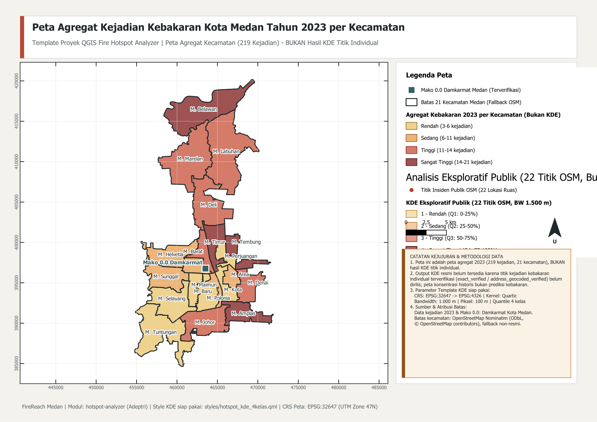
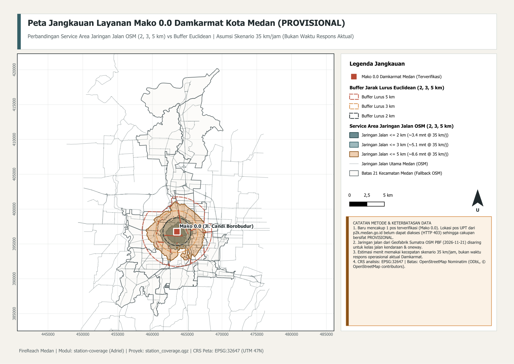
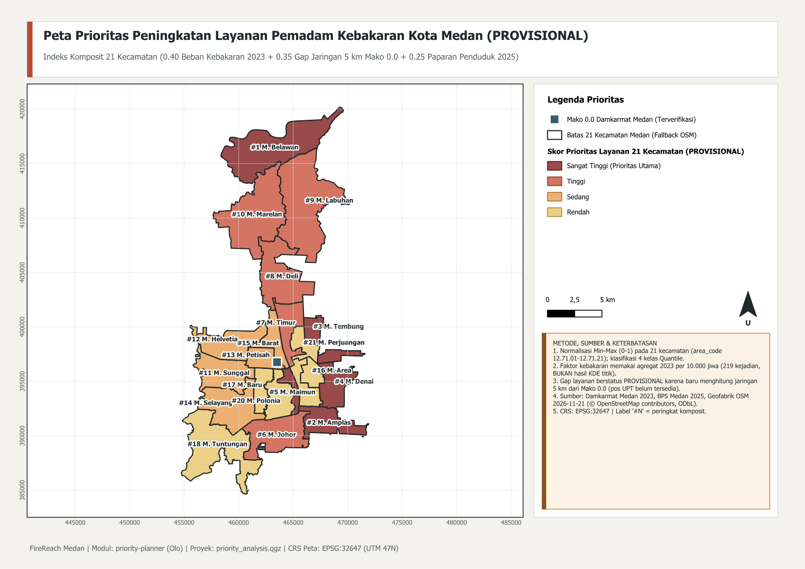

# DRAFT LAPORAN TUGAS AKHIR SISTEM INFORMASI GEOGRAFIS (SIG)

## FireReach Medan: Pemetaan Insiden Kebakaran dan Analisis Jangkauan Layanan Pemadam Kebakaran Kota Medan Berbasis Web GIS dan QGIS

> **STATUS DOKUMEN: DRAFT TERSTRUKTUR UNTUK FINALISASI KAMPUS**
> Laporan ini disusun secara ketat berdasarkan dataset resmi yang telah terverifikasi, ekstraksi jaringan jalan OpenStreetMap, proyek QGIS, serta kode aplikasi FireReach Medan. Bagian bertanda `[LENGKAPI: ...]` wajib diisi oleh tim sesuai format resmi program studi sebelum dikumpulkan. Tidak ada data survei lapangan, wawancara instansi, koordinat pos UPT, maupun titik kejadian kebakaran yang dikarang.

---

## Lembar Identitas (Lengkapi Sebelum Pengumpulan)

- **Judul Tugas Akhir**: Pemetaan Insiden Kebakaran dan Analisis Kesenjangan Jangkauan Layanan Pemadam Kebakaran Kota Medan Menggunakan QGIS dan Web GIS (`FireReach Medan`)
- **Kelompok**: Kelompok 3
- **Program Studi / Fakultas**: `[LENGKAPI: Nama Program Studi, Fakultas, dan Universitas]`
- **Mata Kuliah**: `[LENGKAPI: Nama Mata Kuliah SIG / Praktikum SIG & Semester]`
- **Dosen Pengampu**: `[LENGKAPI: Nama Lengkap & Gelar Dosen Pengampu]`
- **Anggota Tim & Pembagian Modul**:
  1. Fikri (`[LENGKAPI: Nama Lengkap & NIM]`) - Arsitektur Shell Aplikasi Web GIS, Integrasi Data & `incident-explorer`
  2. Adeptri (`[LENGKAPI: Nama Lengkap & NIM]`) - Modul `hotspot-analyzer` (Pipeline KDE & Template QGIS Hotspot)
  3. Adriel (`[LENGKAPI: Nama Lengkap & NIM]`) - Modul `station-coverage` (Service Area Jaringan Jalan OSM vs Euclidean)
  4. Olo (`[LENGKAPI: Nama Lengkap & NIM]`) - Modul `priority-planner` (Indeks Prioritas Multi-Kriteria 21 Kecamatan)
- **Repositori Proyek**: `https://github.com/FikriYuzaki/projek_SIG_kelompok3_firereach_medan` (branch `develop`)
- **Tanggal Penyusunan Draft**: 21 November 2026 (`[LENGKAPI: Tanggal Finalisasi & Pengumpulan Resmi]`)

---

## Ringkasan Eksekutif (Abstrak)

Kebakaran perkotaan di Kota Medan membutuhkan dukungan analisis spasial untuk memahami distribusi beban kejadian serta mengevaluasi keterjangkauan armada pemadam kebakaran pada jaringan jalan nyata. Proyek **FireReach Medan** mengintegrasikan alur kerja Desktop GIS (**QGIS 3.44 / PyQGIS**) dengan aplikasi **Web GIS interaktif** (Leaflet 2D, Chart.js, Vite ES Modules) berbasis standar sistem referensi koordinat metrik **`EPSG:32647` (WGS 84 / UTM Zone 47N)** untuk komputasi geospasial dan **`EPSG:4326` (WGS 84)** untuk pertukaran data web.

Berdasarkan pengolahan data historis Dinas Pemadam Kebakaran dan Penyelamatan Kota Medan periode **2016-2025** melalui Portal Satu Data Medan, tercatat total kumulatif **2.327 kejadian** (termasuk **219 kejadian** teragregasi pada 21 kecamatan di tahun 2023, **269 kejadian** rekap bulanan tahun 2024, dan **251 kejadian** rekap bulanan tahun 2025). Data spasial pendukung mencakup **2.498.293 jiwa** penduduk tahun 2025 dari BPS Kota Medan, batas 21 kecamatan (`12.71.01` hingga `12.71.21`) hasil fallback OpenStreetMap Nominatim (luas poligon kota **278,44 km2**), koordinat terverifikasi **Mako 0.0 Damkarmat Medan** (`3.589536, 98.671447`), serta ekstraksi **44.522 segmen jaringan jalan drivable** sepanjang **6.723,27 km** dari Geofabrik Sumatra OSM PBF.

Hasil analisis jaringan jalan **provisional** dari satu pos terverifikasi (Mako 0.0) menunjukkan bahwa luas *Network Service Area* pada ambang **5.000 m** (skenario teoretis **~8,57 menit** pada asumsi kecepatan **35 km/jam**) hanya mencapai **46,19 km2** atau **16,60%** dari luas Kota Medan, jauh lebih kecil dibanding estimasi lingkaran lurus Euclidean **73,16 km2** (rasio **0,63**). Sebanyak **7 kecamatan** tercatat memiliki **0,0%** cakupan jaringan 5 km dari Mako 0.0 (gap **100%**). Penggabungan indeks prioritas tiga faktor (**40%** beban kebakaran 2023 per 10.000 jiwa, **35%** gap jaringan 5 km, **25%** kepadatan penduduk 2025) menempatkan **5 kecamatan** pada kelas prioritas **Sangat Tinggi**, yaitu **Medan Belawan (`0,750`)**, **Medan Amplas (`0,728`)**, **Medan Tembung (`0,643`)**, **Medan Denai (`0,632`)**, dan **Medan Maimun (`0,583`)**. Seluruh analisis cakupan pos dan prioritas berstatus **PROVISIONAL** karena koordinat pos UPT lainnya di portal `p2k.medan.go.id` masih terblokir (`HTTP 403`) dan data koordinat titik kejadian kebakaran individual untuk KDE formal belum tersedia.

---

## 1. Pendahuluan

### 1.1 Latar Belakang
Kota Medan sebagai pusat metropolitan di Sumatera Utara memiliki kepadatan penduduk yang bervariasi sangat tajam antar-kecamatan, mulai dari **3.336 jiwa/km2** di Medan Belawan hingga **27.981 jiwa/km2** di Medan Area (data BPS Kota Medan 2025). Variasi morfologi jalan raya, keterpisahan koridor utara (Medan Belawan, Medan Labuhan, Medan Marelan) dan selatan/timur terhadap pusat kota, serta keterbatasan keterbukaan data spasial titik kejadian membuat pengambilan keputusan layanan pemadam kebakaran memerlukan sistem yang jujur terhadap tingkat kepastian dan granularitas datanya.

### 1.2 Rumusan Masalah
1. Bagaimana mengintegrasikan data kejadian kebakaran historis Kota Medan yang memiliki granularitas berbeda (tahunan kota, bulanan kota, agregat kecamatan) tanpa mengarang koordinat titik individual?
2. Bagaimana menyiapkan pipeline Kernel Density Estimation (KDE) terstandar pada QGIS (`EPSG:32647`) lengkap dengan validasi ketat dan klasifikasi Quantile 4 kelas yang siap dijalankan begitu titik terverifikasi tersedia?
3. Seberapa besar perbedaan jangkauan layanan Mako 0.0 Damkarmat Medan antara *Buffer Euclidean* dan *Network Service Area* jaringan jalan OSM pada ambang jarak **2.000 m**, **3.000 m**, dan **5.000 m**?
4. Bagaimana menyusun indeks prioritas peningkatan layanan antar-kecamatan secara objektif menggunakan data agregat kebakaran 2023, kesenjangan jaringan jalan Mako 0.0, dan paparan kepadatan penduduk 2025?

### 1.3 Tujuan dan Batasan Studi
Proyek ini bertujuan membangun proyek QGIS portabel, peta layout kartografis (`.PNG`), serta aplikasi Web GIS terintegrasi bagi keempat modul analisis (`incident-explorer`, `hotspot-analyzer`, `station-coverage`, `priority-planner`) dengan prinsip kejujuran data ilmiah:
- Tidak dilakukan survei lapangan ataupun wawancara instansi pada tahap pengerjaan ini (`[LENGKAPI: Jika tim melakukan kunjungan/wawancara resmi Damkarmat sebelum pengumpulan, lampirkan surat tugas/berita acara di sini]`).
- Koordinat pos pemadam kebakaran hanya menggunakan 1 pos yang terverifikasi dari Satu Data Medan (`MAKO-00`), sedangkan slot pos UPT lain tidak direka-reka.
- Fixture `DEMO` dipisahkan secara tegas pada `data/fixtures/demo/` dan `public/data/demo/` dan tidak pernah dicampur ke dalam perhitungan analisis nyata/provisional.

---

## 2. Sumber Data, Provenance, dan Kendala Akses

Seluruh sumber data dicatat beserta tanggal akses, hash integritas SHA-256 (pada `data/metadata/source-register.csv` dan `public/data/manifest.json`), serta batas lisensinya.

| Kode Sumber | Nama Dataset | Penerbit & Sumber | Granularitas | Cakupan / Rekaman | Tanggal Akses | Status & Lisensi |
|---|---|---|---|---|---|---|
| `SRC-FIRE-2016-2022` | Jumlah Kebakaran Kota Medan 2016-2022 | Dinas Damkarmat / Satu Data Medan | Tahunan level kota | 1.588 kejadian | 2026-11-19 | Terverifikasi (Open Data Pemko Medan) |
| `SRC-FIRE-2023` | Rekapitulasi Data Kebakaran Menurut Kecamatan 2023 | Dinas Damkarmat / Satu Data Medan | Agregat 21 kecamatan | 219 kejadian | 2026-11-19 | Terverifikasi (QA selisih +/-1 pada 8 kec.) |
| `SRC-FIRE-2024` | Rekapitulasi Kejadian Kebakaran Tahun 2024 | Dinas Damkarmat / Satu Data Medan | Bulanan (8 kategori objek) | 269 kejadian | 2026-11-19 | Terverifikasi (tanpa kolom kecamatan/titik) |
| `SRC-FIRE-2025` | Rekapitulasi Kejadian Kebakaran Tahun 2025 | Dinas Damkarmat / Satu Data Medan | Bulanan (8 kategori objek) | 251 kejadian | 2026-11-19 | Terverifikasi (tanpa kolom kecamatan/titik) |
| `SRC-STATION-MAKO` | Koordinat Mako 0.0 Damkarmat Kota Medan | Satu Data Medan (`Knowledge Damkarmat`) | Titik tunggal `exact_verified` | 1 pos (`3.589536, 98.671447`) | 2026-11-19 | Terverifikasi |
| `SRC-POP-2025` | Jumlah & Kepadatan Penduduk Kota Medan 2025 | BPS Kota Medan / Satu Data Medan | Agregat 21 kecamatan | 2.498.293 jiwa | 2026-11-19 | Terverifikasi |
| `SRC-POP-2022-2024` | Jumlah Penduduk Kota Medan 2022-2024 | Disdukcapil / Satu Data Medan | Agregat 21 kecamatan | Kode area `12.71.01`-`12.71.21` | 2026-11-19 | Terverifikasi |
| `SRC-BOUNDARY-OSM` | Batas Kota Medan & 21 Kecamatan (Fallback) | OpenStreetMap Nominatim | Poligon 21 kecamatan | 278,44 km2 | 2026-11-19 | Fallback non-resmi (ODbL 1.0, © OpenStreetMap contributors) |
| `SRC-ROADS-GEOFABRIK` | Ekstrak Jaringan Jalan Kota Medan (dari Sumatra PBF) | Geofabrik / OpenStreetMap | Garis jaringan drivable | 44.522 segmen / 6.723,27 km | 2026-11-21 (snapshot 2026-11-20T21:21:03Z) | Diakuisisi lokal ke `EPSG:32647` (ODbL 1.0, © OpenStreetMap contributors) |

### 2.1 Blocker Sumber Data Eksternal
1. **Portal Pos UPT Damkarmat (`https://p2k.medan.go.id/...`)**: Mengembalikan `HTTP 403` tantangan anti-bot Cloudflare sehingga koordinat pos UPT selain Mako 0.0 tidak dapat diambil otomatis (`upt_verified_count = 0`).
2. **Geoportal Resmi Pemko Medan (`https://geoportal.medan.go.id/main/katalog`)**: Mengembalikan `HTTP 403` Cloudflare; digantikan sementara dengan poligon 21 kecamatan OpenStreetMap Nominatim yang diverifikasi mencakup tepat 21 `area_code` (`12.71.01`-`12.71.21`).
3. **Portal BPS Langsung (`medankota.bps.go.id`)**: Mengembalikan `HTTP 520` Akamai TSPD; teratasi bersih melalui unduhan resmi tabel BPS 2025 dan Disdukcapil 2022-2024 di Portal Satu Data Medan.
4. **Titik Alamat Kebakaran Individual**: Portal terbuka hanya menerbitkan agregat bulanan (2024-2025) dan agregat kecamatan (2023), dengan `individual_geocoded_count = 0`.

---

## 3. Arsitektur dan Metodologi Pengolahan SIG

### 3.1 Disiplin Sistem Referensi Koordinat (CRS)
- **Komputasi Spasial Metrik (`EPSG:32647`, WGS 84 / UTM Zone 47N)**: Seluruh perhitungan luas wilayah, jarak lurus Euclidean, panjang jaringan jalan, jarak graf *Service Area*, dan ukuran piksel/bandwidth KDE dijalankan dalam satuan meter pada UTM Zone 47N.
- **Pertukaran & Web GIS (`EPSG:4326`, WGS 84)**: GeoJSON untuk web map interaktif dan basis data PostGIS diekspor ke `EPSG:4326` setelah seluruh perhitungan metrik selesai.

### 3.2 Metodologi Modul 1: Fire Incident Explorer (`incident-explorer`)
- Menyajikan empat seri agregat terverifikasi: **2023 menurut 21 kecamatan** (219 kejadian), **2024 bulanan menurut objek** (269 kejadian), **2025 bulanan menurut objek** (251 kejadian), serta **seri tahunan 2016-2025** (2.327 kejadian kumulatif).
- Menyimpan catatan anomali kualitas data (`data_quality_anomalies`) termasuk perbedaan skala objek pada 8 kecamatan tahun 2023 (`+/-1`), nilai kerugian material Maret 2023 (`776`), dan perbedaan angka penanggulangan dalam/luar kota tahun 2019-2021.

### 3.3 Metodologi Modul 2: Fire Hotspot Analyzer (`hotspot-analyzer`)
Pipeline `qgis/hotspot-analysis/run_kde_pipeline.py` dan modul inti `kde_core.py` menerapkan metodologi KDE terstandardisasi:
- **Validasi Input Ketat**: Hanya menerima titik dengan `incident_id` unik non-kosong, `incident_date` valid, `verification_status == "verified"`, `location_accuracy` termasuk `exact_verified` atau `address_geocoded_verified`, bukan catatan `DEMO`, geometri `Point`, dan lolos uji *point-in-polygon* di dalam batas Kota Medan.
- **Parameter KDE**: Algoritma `qgis:heatmapkerneldensityestimation` dengan **Kernel Quartic**, radius pencarian (**bandwidth**) **1.000 meter**, dan ukuran piksel **100 meter x 100 meter** dalam `EPSG:32647`.
- **Klasifikasi Quantile 4 Kelas Aktual**: Menyingkirkan piksel *NoData*, membatasi populasi piksel ke dalam poligon Kota Medan, mengeluarkan nilai latar non-positif (`<= 0`) agar tidak mendistorsi sebaran hotspot, dan menghitung persentil ke-25 (`Q25`), ke-50 (`Q50`), dan ke-75 (`Q75`) atas piksel positif menjadi 4 kelas: **Rendah**, **Sedang**, **Tinggi**, dan **Sangat Tinggi**.
- **Kondisi Saat Ini**: Karena 0 titik kejadian individual terverifikasi tersedia, pipeline KDE tidak dijalankan secara paksa dan tidak mempublikasikan raster palsu; proyek QGIS (`medan_hotspot_template.qgz`) dan peta PNG menyajikan **agregat kejadian 2023 per kecamatan** disertai peringatan eksplisit bahwa peta tersebut **BUKAN hasil KDE**, sedangkan UI Web menampilkan fixture `DEMO` dengan penanda visual yang jelas.

### 3.4 Metodologi Modul 3: Fire Station Coverage (`station-coverage`)
1. **Validasi Stasiun**: `coverage_core.py` hanya menerima stasiun berstatus `verified`, bukan `DEMO`, koordinat valid, dan berada di dalam poligon Kota Medan (`MAKO-00` diterima; `DEMO-UPT-1` ditolak).
2. **Ekstraksi Jaringan Jalan OSM**: `extract_medan_roads.py` membaca `sumatra-latest.osm.pbf` melalui GDAL/OGR, memfilter kelas jalan drivable (`motorway`, `trunk`, `primary`, `secondary`, `tertiary`, `unclassified`, `residential`, `service`, `living_street`, dan kelas `*_link`), menyingkirkan jalan bertanda akses tertutup (`private`/`no` = **6.898** segmen), lalu mereproyeksi ke `EPSG:32647` dan memotong ke batas Kota Medan + buffer 2.000 m (**44.522** segmen, total **6.723,27 km**; arah `BOTH: 41.067`, `F: 3.453`, `B: 2`).
3. **Buffer Euclidean vs Network Service Area**:
   - Buffer Euclidean dihitung pada radius **2.000 m**, **3.000 m**, dan **5.000 m** (`SEGMENTS = 24`) lalu diklip ke batas Kota Medan.
   - *Network Service Area* dihitung dengan algoritma `native:serviceareafromlayer` (`STRATEGY = Shortest path (distance)`, `POINT_TOLERANCE = 250 m`, arah `oneway_dir`), menghasilkan segmen jalan terjangkau (`5.019`, `14.217`, dan `42.329` segmen) yang dibuffer koridor **150 m** melalui chunking geometri (`500` segmen/batch) dan *cascaded unary union* lalu diklip ke batas kota.
   - Konversi waktu tempuh memakai rumus skenario `menit = (jarak_m / 1.000 / 35) * 60` (`~3,43`, `~5,14`, dan `~8,57` menit pada **35 km/jam**), disertai disclaimer bahwa angka tersebut adalah **estimasi skenario teoretis dan bukan waktu respons aktual Damkarmat**.

### 3.5 Metodologi Modul 4: Fire Service Priority Planner (`priority-planner`)
- **Penggabungan Eksak 21 Kecamatan**: Menggunakan primary key `area_code` (`12.71.01`-`12.71.21`) untuk menggabungkan tabel agregat kebakaran 2023, penduduk & kepadatan BPS 2025, poligon kecamatan OSM, dan cakupan jaringan 5 km dari `station-coverage`. Validator melarang kode duplikat, kecamatan hilang, maupun nilai `null` yang dianggap nol.
- **Pembentukan Indikator & Normalisasi Min-Max**:
  - `hotspot_score`: menormalkan tingkat insiden 2023 per 10.000 penduduk (`incidents_2023 / population_2025 * 10.000`, rentang `0,2824` s.d. `1,8922` kejadian per 10.000 jiwa) karena titik KDE resmi belum tersedia.
  - `coverage_gap_score`: menormalkan `network_5km_gap_ratio` (`1 - luas_terjangkau_5km / luas_kecamatan`, rentang `0,0` s.d. `1,0`) dari hasil Mako 0.0 (**PROVISIONAL**).
  - `population_exposure_score`: menormalkan `density_km2_2025` (rentang `3.336` s.d. `27.981 jiwa/km2`; terdeteksi 1 outlier statistik `1.5*IQR` pada `12.71.10` Medan Area).
  - Seluruh faktor memakai **Min-Max Normalization** arah *benefit* `(x - min) / (max - min)` pada rentang `[0, 1]` dan guardrail mode parsial apabila `coverage_gap_score` tidak tersedia.
- **Rumus Indeks Komposit & Klasifikasi Tier**:
  $$\text{composite\_score} = 0,40 \cdot \text{hotspot\_score} + 0,35 \cdot \text{coverage\_gap\_score} + 0,25 \cdot \text{population\_exposure\_score}$$
  Skor komposit diklasifikasikan ke dalam **4 kelas Quantile** (`Q25 = 0,386911`, `Q50 = 0,426501`, `Q75 = 0,547040`): **Rendah**, **Sedang**, **Tinggi**, dan **Sangat Tinggi**. Pada antarmuka web disediakan simulasi bobot *What-If* (total wajib `100%`) yang hanya mengubah tampilan sesi interaktif tanpa mengubah bobot metodologi standar.

---

## 4. Hasil Analisis Spasial

### 4.1 Rekapitulasi Kebakaran Kota Medan (Peta 1 - Bukan KDE)

Peta 1 memperlihatkan sebaran **219 kejadian kebakaran tahun 2023** pada tingkat poligon kecamatan (bukan permukaan kerapatan KDE titik). Kecamatan dengan jumlah kejadian mentah tertinggi adalah **Medan Belawan** (**21 kejadian**), **Medan Amplas** (**19 kejadian**), **Medan Timur** (**16 kejadian**), **Medan Tembung** (**15 kejadian**), **Medan Denai** (**14 kejadian**), dan **Medan Deli** (**14 kejadian**). Selisih angka objek terhadap skala skala-kebakaran sebesar `+/-1` tetap tercatat pada 8 kecamatan (`12.71.01`, `12.71.02`, `12.71.03`, `12.71.13`, `12.71.14`, `12.71.17`, `12.71.19`, `12.71.20`) tanpa dihilangkan.

### 4.2 Perbandingan Jangkauan Euclidean vs Jaringan Jalan Mako 0.0 (Peta 2 - PROVISIONAL)

Tabel berikut membandingkan luas poligon cakupan antara metode lingkaran lurus (Euclidean) dan penelusuran graf jaringan jalan OSM nyata dari **Mako 0.0** terhadap luas total poligon Kota Medan (**278,44 km2**):

| Ambang Jarak | Skenario Waktu (@ 35 km/jam, Bukan Aktual) | Luas Buffer Euclidean (km2) | Luas Network Service Area (km2) | Rasio Network / Euclidean | Panjang Jalan Terjangkau (km) | % Cakupan terhadap Luas Kota Medan |
|---:|---:|---:|---:|---:|---:|---:|
| 2.000 m | ~3,43 menit | 12,53 km2 | 6,22 km2 | 0,50 | 132,49 km | 2,23% |
| 3.000 m | ~5,14 menit | 28,22 km2 | 15,89 km2 | 0,56 | 406,96 km | 5,71% |
| 5.000 m | ~8,57 menit | 73,16 km2 | 46,19 km2 | 0,63 | 1.265,40 km | 16,60% |

Analisis membuktikan bahwa metode Euclidean melebih-lebihkan jangkauan nyata di perkotaan sebesar **58% hingga 101%** (rasio network/Euclidean hanya **0,50** di 2 km dan **0,63** di 5 km) akibat efek koridor jalan, sungai, persilangan rel, dan aturan satu arah (`3.453` segmen *oneway* maju). Pada batas **5.000 m jaringan jalan**, hanya **14 kecamatan** yang terjangkau sebagian atau penuh (`100%` pada **Medan Petisah**, `96,2%` **Medan Perjuangan**, `91,1%` **Medan Barat**), sementara **7 kecamatan** memiliki **0,0% cakupan** dari Mako 0.0 (yaitu **Medan Belawan**, **Medan Labuhan**, **Medan Marelan**, **Medan Tuntungan**, **Medan Deli**, **Medan Amplas**, dan **Medan Johor**, dengan jarak sentroid `6,65 km` hingga `19,74 km`).

### 4.3 Peringkat Prioritas 21 Kecamatan Kota Medan (Peta 3 - PROVISIONAL)

Distribusi kelas hasil klasifikasi 4-kelas Quantile adalah **5 kecamatan Sangat Tinggi**, **5 kecamatan Tinggi**, **5 kecamatan Sedang**, dan **6 kecamatan Rendah**. Tabel lengkap 21 kecamatan berikut merupakan keluaran resmi modul `priority-planner`:

| Peringkat | Kode | Kecamatan | Kejadian 2023 | Rate / 10 rb Jiwa | Kepadatan 2025 (/km2) | Jangkauan Net 5 km (%) | Skor Hotspot | Skor Gap | Skor Penduduk | Skor Komposit | Tier Prioritas |
|---:|---|---|---:|---:|---:|---:|---:|---:|---:|---:|---|
| 1 | `12.71.08` | Medan Belawan | 21 | 1,8922 | 3.336 | 0,0% | 1,000 | 1,000 | 0,000 | **0,750** | Sangat Tinggi |
| 2 | `12.71.09` | Medan Amplas | 19 | 1,4283 | 12.491 | 0,0% | 0,712 | 1,000 | 0,371 | **0,728** | Sangat Tinggi |
| 3 | `12.71.14` | Medan Tembung | 15 | 0,9934 | 19.234 | 12,8% | 0,442 | 0,872 | 0,645 | **0,643** | Sangat Tinggi |
| 4 | `12.71.04` | Medan Denai | 14 | 0,8081 | 18.491 | 0,7% | 0,327 | 0,993 | 0,615 | **0,632** | Sangat Tinggi |
| 5 | `12.71.15` | Medan Maimun | 9 | 1,8006 | 16.550 | 79,5% | 0,943 | 0,205 | 0,536 | **0,583** | Sangat Tinggi |
| 6 | `12.71.11` | Medan Johor | 13 | 0,8289 | 9.374 | 0,0% | 0,339 | 1,000 | 0,245 | **0,547** | Tinggi |
| 7 | `12.71.20` | Medan Timur | 16 | 1,3680 | 13.156 | 50,3% | 0,674 | 0,498 | 0,398 | **0,543** | Tinggi |
| 8 | `12.71.06` | Medan Deli | 14 | 0,7247 | 10.260 | 0,0% | 0,275 | 1,000 | 0,281 | **0,530** | Tinggi |
| 9 | `12.71.13` | Medan Labuhan | 12 | 0,8775 | 3.897 | 0,0% | 0,370 | 1,000 | 0,023 | **0,504** | Tinggi |
| 10 | `12.71.12` | Medan Marelan | 12 | 0,6183 | 6.463 | 0,0% | 0,209 | 1,000 | 0,127 | **0,465** | Tinggi |
| 11 | `12.71.02` | Medan Sunggal | 9 | 0,6616 | 10.259 | 25,1% | 0,236 | 0,749 | 0,281 | **0,427** | Sedang |
| 12 | `12.71.03` | Medan Helvetia | 9 | 0,5281 | 13.060 | 23,9% | 0,153 | 0,761 | 0,395 | **0,426** | Sedang |
| 13 | `12.71.19` | Medan Petisah | 11 | 1,5118 | 13.780 | 100,0% | 0,764 | 0,000 | 0,424 | **0,411** | Sedang |
| 14 | `12.71.21` | Medan Selayang | 5 | 0,4776 | 6.365 | 5,5% | 0,121 | 0,945 | 0,123 | **0,410** | Sedang |
| 15 | `12.71.05` | Medan Barat | 12 | 1,3393 | 14.132 | 91,1% | 0,657 | 0,089 | 0,438 | **0,403** | Sedang |
| 16 | `12.71.10` | Medan Area | 7 | 0,5900 | 27.981 | 82,7% | 0,191 | 0,173 | 1,000 | **0,387** | Rendah |
| 17 | `12.71.17` | Medan Baru | 5 | 1,3912 | 6.619 | 78,2% | 0,689 | 0,218 | 0,133 | **0,385** | Rendah |
| 18 | `12.71.07` | Medan Tuntungan | 3 | 0,2941 | 4.054 | 0,0% | 0,007 | 1,000 | 0,029 | **0,360** | Rendah |
| 19 | `12.71.01` | Medan Kota | 6 | 0,7078 | 14.743 | 62,0% | 0,264 | 0,380 | 0,463 | **0,354** | Rendah |
| 20 | `12.71.16` | Medan Polonia | 4 | 0,6543 | 6.971 | 51,6% | 0,231 | 0,484 | 0,147 | **0,299** | Rendah |
| 21 | `12.71.18` | Medan Perjuangan | 3 | 0,2824 | 23.399 | 96,2% | 0,000 | 0,038 | 0,814 | **0,217** | Rendah |

---

## 5. Pembahasan dan Rekomendasi Solusi Berbasis Bukti

### 5.1 Prioritas Penguatan Kesiapsiagaan Koridor Selatan-Tenggara dan Utara (Provisional)
- Empat dari lima kecamatan tier **Sangat Tinggi** (**Medan Belawan**, **Medan Amplas**, **Medan Tembung**, dan **Medan Denai**) memiliki kombinasi beban kejadian 2023 tinggi (**14-21 kejadian**) sekaligus kesenjangan jaringan 5 km dari Mako 0.0 sebesar **87,2% hingga 100%**. Wilayah **Medan Johor**, **Medan Deli**, **Medan Labuhan**, dan **Medan Marelan** di tier **Tinggi** juga seluruhnya berada di luar jangkauan 5 km Mako 0.0 (`gap = 1,000`).
- Rekomendasi evaluatif: integrasikan koordinat seluruh pos UPT Damkarmat yang sudah beroperasi di lapangan ke dalam `station-coverage` sebelum menarik kesimpulan pembangunan pos baru, karena secara operasional pos UPT di Medan Utara dan kawasan penyangga kemungkinan telah menutup sebagian gap tersebut namun belum terdokumentasi di portal terbuka.

### 5.2 Intervensi Pencegahan Kebakaran Berbasis Kepadatan & Beban Historis
- **Medan Maimun** masuk kelas **Sangat Tinggi** (`0,583`) meskipun berjarak dekat dengan Mako 0.0 (`cakupan 5 km = 79,5%`) karena rasio kejadiannya mencapai **1,80 per 10.000 jiwa** (`hotspot_score = 0,943`) pada kepadatan **16.550 jiwa/km2**. Kawasan ini tepat diarahkan pada program mitigasi preventif lingkungan padat dan inspeksi hidran/akses gang dibanding sekadar perluasan jangkauan stasiun.

### 5.3 Tata Kelola Data Spasial Kota Medan
- Mendorong penerbitan log insiden teranonymisasi dengan koordinat/alamat terstruktur serta publikasi shapefile/GeoJSON batas kelurahan dan lokasi pos UPT resmi di Satu Data Medan sehingga analisis **KDE Hotspot** (`100 m` piksel) dan **Network Service Area multi-pos** dapat dihitung secara penuh.

---

## 6. Keterbatasan Data & Atribusi Geospasial

### 6.1 Ringkasan Keterbatasan
- Cakupan layanan dalam dokumen ini masih **PROVISIONAL** karena hanya dihitung dari **Mako 0.0** (pos UPT lainnya terblokir di `p2k.medan.go.id` HTTP 403).
- `hotspot_score` pada Priority Planner menggunakan angka agregat kejadian 2023 per 10.000 jiwa, **bukan** kepadatan KDE titik individual.
- Batas 21 kecamatan menggunakan fallback **OpenStreetMap Nominatim** bukan batas resmi Badan Informasi Geospasial / Geoportal Pemko Medan (`HTTP 403`).
- Estimasi waktu tempuh **35 km/jam** bersifat asumsi skenario statis dan tidak memodelkan kemacetan lalu lintas, sinyal lalu lintas, maupun hambatan geometrik jalan sempit.

### 6.2 Atribusi Resmi
- **Data Jalan & Batas Fallback**: OpenStreetMap contributors via Geofabrik & Nominatim (`ODbL 1.0`, `© OpenStreetMap contributors`).
- **Data Kejadian Kebakaran, Lokasi Mako 0.0, dan Kependudukan**: Pemerintah Kota Medan melalui Portal Satu Data Medan, Dinas Pemadam Kebakaran dan Penyelamatan Kota Medan, dan Badan Pusat Statistik (BPS) Kota Medan.

---

## 7. Penutup dan Daftar Lampiran

Sistem Web GIS **FireReach Medan** dan tiga proyek QGIS (**`medan_hotspot_template.qgz`**, **`station_coverage.qgz`**, dan **`priority_analysis.qgz`**) telah berhasil diintegrasikan pada branch `develop` dengan seluruh pengujian unit Python, PyQGIS smoke test, ESLint, Vitest, Vite production build, dan Playwright E2E berjalan selaras serta menjunjung kejujuran ilmiah atas data yang tersedia.

### Daftar Lampiran Paket Pengumpulan
- **Lampiran A (`01_Peta_Layout_PNG/`)**:
  1. `peta_agregat_kebakaran_medan_2023_template_kde.png`
  2. `peta_jangkauan_pos_damkarmat_medan_mako00.png`
  3. `peta_prioritas_layanan_kebakaran_medan_provisional.png`
- **Lampiran B (`02_Proyek_QGIS/`)**: Seluruh proyek `.qgz` berpath relatif beserta layer GeoPackage/GeoJSON, style `.qml`, skrip pemrosesan PyQGIS (`kde_core.py`, `coverage_core.py`, `priority_core.py`, serta skrip runner/builder masing-masing), dan dokumentasi `README.md`.
- **Lampiran C (`03_Web_Map_Interaktif/`)**: Hasil build statis aplikasi Web GIS **FireReach Medan** (`dist/`).
- **Lampiran D (`04_Makalah_Laporan/`)**: Naskah Markdown sumber & dokumen `.PDF` terkompilasi.
